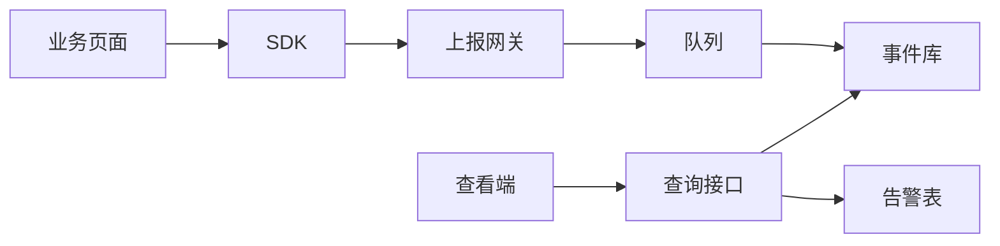

# 前端监控系统方案设计

本方案做 Web 真实用户监控：浏览器上报一次访问，平台按应用、环境、版本和时间算出可比较的指标，并在最近 10 分钟明显变差时告警。方案只负责发现和定位。

## 1. 看什么

要回答四件事：整体变好还是变差，问题在哪个页面、错误、接口或访问，是不是某个版本带来的，以及现在要不要处理。


| 看法  | 看什么                                                                        |
| --- | -------------------------------------------------------------------------- |
| 整体  | 无错误会话率、独立用户、受影响用户、P75 LCP、API 成功率、白屏率；体验健康度；LCP / INP / API P95 / JS 错误率趋势 |
| 页面  | 每个路由的 PV、受影响用户、体验指标、JS 错误率、API P95、达标率；资源还是接口拖慢                            |
| 异常  | 脚本异常、未处理的 Promise、资源加载失败。同一堆栈加同一版本合成一组，看出现在哪个页面、次数、影响用户，以及最近 1 小时是否还在上报。再往下看堆栈和最近一次访问 |
| 接口  | P50、P95、错误率、超时率、近 5 分钟 QPS、Trace 覆盖率，以及出现在哪些页面                             |
| 会话  | 同一次 `sessionId` 的步骤。有脚本错误为异常；LCP 超过缓慢线为缓慢（手机 3 秒，其他 2.5 秒）                 |
| 版本  | 同一环境里，与首次出现更早的上一版本比全部上报                                                    |
| 告警  | 最近 10 分钟的当前值、基线、影响人数。动作是认领、静默、标记误报、进入排障                                    |


应用、环境、版本、时间是同一套范围。时间只有近 24 小时、近 7 天、近 30 天。搜索也走这套范围。

良好线共用一份。五项体验指标取 Web Vitals 的 Good 线，用 P75 判断；后两项是本方案的服务水平。


| 指标                           | 良好线                                     |
| ---------------------------- | --------------------------------------- |
| LCP / FCP / INP / CLS / TTFB | ≤ 2.5 秒 / 1.8 秒 / 200 毫秒 / 0.1 / 800 毫秒 |
| JS 错误率 / API P95             | ≤ 0.5% / 800 毫秒                         |


没有样本就留空。环比用等长的上一时段，上一时段没有样本时变化值留空。页面达标率只统计有样本的检查，体验健康度按 PV 加权，达到 75% 为良好。

受影响用户用更严的极差线：有错误，或 LCP > 4 秒、INP > 500 毫秒、CLS > 0.25、TTFB > 1.8 秒，或接口 5xx、状态码 0、超时。

告警、QPS、异常是否仍在发生不跟查看时间走，分别用最近 10 分钟、5 分钟、1 小时。

## 2. 怎么用

```text
整体变差
  -> 体验健康度指出哪一类不达标
  -> 页面找出拖后腿的路由，区分资源和接口
  -> 异常或接口确认原因
  -> 会话看这次访问的步骤
  -> 版本对比判断是不是新版本引入
  -> 告警只在最近 10 分钟已经值得处理时出现
```

版本对比不套用查看时间。告警列表按最后出现时间过滤，不改变规则本身。

业务页面只在入口初始化一次。Vue 写在 `createApp` 之前，React 写在 `createRoot` 之前：

```ts
afmInit({
  projectId: '<project-id>',
  env: 'production',
  endpoint: '<ingest-endpoint>',
})
```

版本依次取 `release`、`<meta name="afm-release">`、`window.__AFM_RELEASE__`。占位符 `__AFM_RELEASE__` 没被替换时，当成没有版本。自动采集覆盖不到的事实，才用 `afmTrackError`、`afmTrackApiTiming`、`afmTrackResource`。

## 3. 怎么设计



| 块 | 做什么 | 不做什么 |
| --- | --- | --- |
| SDK | 采集这次访问，POST 给网关 | 不算 PV、P75、错误率 |
| 上报网关 | 拆成一行行，放进队列，马上返回 | 不算指标，不查历史 |
| 事件库 | 只追加。上海时间，保留 90 天 | 不修改已写入的行，不另存汇总表 |
| 告警表 | 记「最近 10 分钟变差」，以及认领、静默、误报 | 不跟查看用的 24 小时、7 天、30 天走 |
| 查询接口 | 打开页面时数事件库里的行 | 查看端不直接连事件库和告警表 |

打开 `https://shop.example/orders/1001?tab=1`，去掉查询参数，`1001` 写成 `:id`。下面几行会话号相同，路由都是 `/orders/:id`。

| 写入一行 | 这行的内容 | 没有就不写 |
| --- | --- | --- |
| 页面访问 | 完整地址仍带 `1001`，计 1 次 PV | |
| 体验指标 | 例如 LCP = 1820 毫秒 | 浏览器没给出的指标 |
| 接口 | 路径、耗时、状态码。每个请求一行 | |
| 错误 | 错误名、堆栈 | 这次没报错 |

看订单页时，取出路由 = `/orders/:id` 的行。`/orders/1002` 也进这一路由。

| 页面上的数 | 怎么算 | 没有这样的行 |
| --- | --- | --- |
| PV | 页面访问有几行就是几。两个订单地址各算一次 | 空 |
| LCP | 这些数的第 75 位 | 空，不显示 0 |
| 接口 P50 / P95 | 耗时的正中间、第 95 位 | 空 |

| 最近 10 分钟 | 告警表 |
| --- | --- |
| 该路由 LCP 第 75 位过严重线，还没有这条 | 新建 |
| 已有同一应用、环境、路由、指标 | 改当前值和最后出现时间 |
| 人点认领、静默、误报 | 只改这一条的状态 |
| 查看端改成近 7 天 | 这条告警仍用那 10 分钟 |

## 4. 工作原理

采集在浏览器里做完，再 POST 一份 JSON 到接入地址。网关拆成明细，分位和比率在查询时现算。


| 事实 | 浏览器本身 | 方案怎么采 | 怎么上报 |
| --- | --- | --- | --- |
| 性能指标 | 已经算好 TTFB、FCP、LCP、CLS、INP | 读导航计时和 `PerformanceObserver`。一次打开页面只出一套，路由切换不重新计。TTFB、FCP 读到就取。LCP 会随更大的内容出现而变大，连续 5 秒不再变大才取当时的值。CLS 把用户没在操作时的偏移加在一起。INP 取各次点击、输入耗时里偏慢的那次。浏览器没有对应类型则这一项留空 | 每个指标各发一次请求。JSON 里有个 `metrics` 字段，只放这一个数，例如 `{ "metrics": { "lcp": 1820 } }`。TTFB、FCP 一读到就发。LCP 连续 5 秒不再变大就发；用户切走标签页、最小化或关掉页时如果还没发，就补发当时的值。CLS、INP 要等这次访问结束才有最终值，所以只在用户离开这个标签页时发。这几次请求都不算一次页面访问 |
| JS 错误 | 出错时派发事件，没有查询历史错误的接口 | `error` 冒泡记脚本异常，标 `js`；`unhandledrejection` 记未处理的 Promise，标 `promise`；捕获阶段的 `error` 看元素 `src` 或 `href`，标 `resource`。堆栈取前 3 帧做哈希，连同 `name`、`message` 一起带上 | 先记在页面内存里，不马上发请求。浏览器空闲时，或最迟 2 秒后，和这段时间积下的接口、资源合成一次 POST，放进 `errors`。用户离开标签页时把还没发出的用 `sendBeacon` 送出，没接住再用 `keepalive`。`afmTrackError` 不暂存，调用时单独发 |
| 接口耗时 | Resource Timing 里有每次请求的耗时 | 替换 `fetch` 和 XHR，用 `performance.now()` 相减。同时带上状态码、是否超时、`traceparent` 或 `x-trace-id`。路径按第 3 节收成稳定路由。上报地址自己的请求不记 | 和错误记在同一处内存里，同一次 POST 放进 `apiTimings`。`afmTrackApiTiming` 不暂存，调用时单独发。P50、P95 在查询时按这些耗时现算 |
| 资源 | Resource Timing 里有图片、脚本的体积和耗时 | 用户离开这个标签页时读取，最多 20 条，跳过上报地址 | 也先记在这处内存里，同一次 POST 放进 `resources`。不拿来算接口分位 |
| 页面访问 | 能看到地址和 `history` 变化 | 初始化发当前页；`pushState`、`replaceState`、后退、hash 变化后，完整地址变了再发一条 | 立即 POST，只有 `recordPageView` 为真才记 PV |


这处内存按错误、接口、资源分三列，每列最多 50 条，多出来的丢掉。发出去之后清空。发送失败不影响页面，也不重试。网关看到 `metrics` 里有一个数，就写成一行体验指标；`errors`、`apiTimings`、`resources` 里的每一项也各写成一行，然后入队。

告警按页面或接口独立判断：达到严重线为 S0；未过不良线不告警；介于两者之间时，没有基线就告警，有基线则要高于基线 1.2 倍才记为 S1。基线不含最近 10 分钟。同一指纹只更新当前值、基线和最后出现时间。


| 规则      | 样本门槛      | 不良线   | 严重线 |
| ------- | --------- | ----- | --- |
| LCP P75 | 至少 1 个样本  | 2.5 秒 | 4 秒 |
| JS 错误率  | 至少 5 个会话  | 1%    | 10% |
| 接口错误率   | 至少 20 次请求 | 2%    | 10% |


## 5. 方案边界

不包含源码映射、发布系统元数据、通知渠道、可改口径的规则界面、地理位置、采样加权、每次路由一套 Web Vitals、长任务、导航类型、请求重试、治理任务、修复验收和自动诊断。